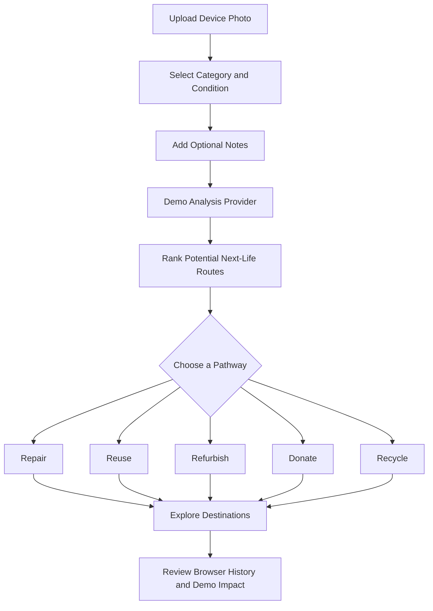

# ♻️ SecondLife AI

<div align="center">

# Don't discard it.
# Discover its next life.

**An AI-inspired e-waste intelligence platform that transforms unused electronics into opportunities for repair, reuse, refurbishment, donation, and responsible recycling.**

Give every device a second chance. Turn electronic waste into environmental value.

<p>
  
  
  
  
</p>

[Explore the Features](#-features) · [Getting Started](#-getting-started) · [How It Works](#-how-it-works) · [Architecture](#-architecture) · [Roadmap](#-roadmap)

</div>

---

## 🌍 The Problem

Electronic waste is one of the world's fastest-growing waste streams. Many discarded devices still contain reusable components, recoverable materials, or opportunities for repair.

Yet people often face the same questions:

- Can this device be repaired?
- Is it worth refurbishing?
- Could someone else reuse it?
- Where can it be donated?
- How should it be recycled responsibly?

**SecondLife AI is designed to make those next-life decisions easier.**

Instead of treating every unwanted device as waste, the platform explores its potential for a more sustainable future.

## 💡 What Is SecondLife AI?

SecondLife AI is a web-based e-waste decision-support prototype that guides users through possible next steps for electronics they no longer need.

Users can provide a device photo, select its category and condition, add relevant notes, and explore ranked recommendations for its next possible use.

The experience combines a story-driven landing page, an interactive analysis workflow, a destination directory, and an impact dashboard in a modern, sustainability-focused interface.

The long-term vision is to connect device assessment with real AI models, verified local repair services, donation partners, refurbishers, and authorized recycling facilities.

**Core philosophy: Repair first. Reuse intelligently. Recover responsibly.**

## ✨ Features

### 🔍 1. Electronic Device Analysis

Explore potential next steps for an unwanted electronic device.

- Upload a device photograph.
- Select the device category.
- Specify its current condition.
- Add contextual notes.
- View ranked next-life recommendations.
- Review the reasoning and suggested actions.
- Explore possible routes for repair, reuse, refurbishment, donation, and recycling.

**Current implementation:** Analysis uses a deterministic demo provider rather than a connected AI model. Results are illustrative and should not be treated as professional repair, valuation, or recycling advice.

### ♻️ 2. Multiple Next-Life Pathways

Different devices require different solutions. SecondLife AI organizes potential outcomes into five sustainability pathways.

| Pathway | Purpose |
|---|---|
| 🔧 Repair | Explore whether a device could be restored to working condition. |
| 🔄 Reuse | Identify opportunities to continue using a device or its components. |
| 🛠️ Refurbish | Consider restoring a device for another user or purpose. |
| 💚 Donate | Explore opportunities to pass usable electronics to others. |
| ♻️ Recycle | Consider responsible recovery of materials through suitable recycling channels. |

Recommendations depend on the information supplied and the prototype's current rules. They do not establish that a device is safe, repairable, or economically viable.

### 🧭 3. Destination Discovery

Explore destination categories relevant to the next life of an electronic device.

- Search the destination directory.
- Filter available destination types.
- Review illustrative destination information.
- Explore the intended journey from a device recommendation to an appropriate destination.

**Demo limitation:** Current destination entries are fictional examples. The location interface does not retrieve verified nearby providers, and displayed distances are based on a demo city centre.

### 📊 4. Sustainability Impact Dashboard

Explore the potential impact of making more responsible decisions about electronic waste.

- View the dashboard's sample metrics.
- Review analyses saved in the current browser.
- Explore the relationship between device decisions and sustainability outcomes.
- Understand how future integrations could track reuse, repair, donation, and recycling activity.

**Demo limitation:** Sample dashboard figures are synthetic. Browser-stored analysis history is not a verified record of real-world environmental outcomes.

### 🔄 5. Six-Stage Workflow

The process page explains the intended journey from submitting a device to tracking its impact.

1. **Upload** — Provide a device photograph.
2. **Identify** — Supply the category and condition.
3. **Analyze** — Generate demo recommendations.
4. **Decide** — Compare possible next-life pathways.
5. **Connect** — Explore destination categories.
6. **Track** — Review available analysis and illustrative impact information.

The current prototype demonstrates this workflow without claiming that every stage is connected to an external service.

### 🔐 6. Privacy Transparency

The privacy page explains how the prototype handles submitted information and locally stored history.

- Clearly distinguish browser storage from server-side storage.
- Document photo-handling behavior accurately.
- Explain the limitations of demo analysis.
- Avoid implying that a real AI provider is processing images when no such service is connected.

Review the implementation and privacy page before assuming that uploaded photos are retained, deleted, or transmitted in a particular way.

### 🎬 7. Immersive User Experience

The interface combines modern frontend engineering with carefully controlled motion.

- Story-led landing page.
- Framer Motion interface animations.
- GSAP-powered motion where implemented.
- Lenis smooth scrolling on supported devices.
- Lazy-loaded Three.js visual scenes.
- SVG fallback when WebGL is unavailable.
- Responsive layouts.
- Reduced-motion support.

The visual experience is designed to make sustainability information approachable without sacrificing usability.

---

## 🧠 How It Works



This diagram represents the current prototype workflow. The analysis stage uses predefined demo logic, and destination discovery does not yet connect to verified local providers.

## 🛠️ Technology Stack

| Technology | Role |
|---|---|
| Next.js 15 | Application framework and routing |
| React 19 | Interactive component system |
| TypeScript | Type-safe application development |
| Tailwind CSS | Styling and responsive layouts |
| Framer Motion | Interface transitions and animations |
| GSAP | Advanced motion effects where implemented |
| Lenis | Smooth scrolling on supported devices |
| Three.js | 3D visual experience |
| SVG | Lightweight visual fallback |
| Browser localStorage | Local analysis history |
| Vercel | Deployment platform |

## 🚀 Getting Started

### Prerequisites

- Node.js version compatible with the project dependencies.
- npm or the package manager specified by the repository lockfile.
- Git.

### 1. Clone the repository

```bash
git clone <YOUR_SECOND_LIFE_AI_REPOSITORY_URL>
cd <YOUR_PROJECT_DIRECTORY>
```

Replace the placeholders with your actual repository URL and directory name.

### 2. Install dependencies

```bash
npm install
```

Use the package manager that matches the existing lockfile.

### 3. Start the development server

```bash
npm run dev
```

Open [http://localhost:3000](http://localhost:3000).

### 4. Create a production build

```bash
npm run build
```

### 5. Run linting and type checks

```bash
npm run lint
npx tsc --noEmit
```

Verify that these scripts are available in `package.json` before running them. The commands above reflect the documented project workflow.

## 📄 Application Routes

| Route | Description |
|---|---|
| `/` | Story-driven introduction, problem, solution, workflow, and impact |
| `/analyze` | Device submission and ranked demo recommendations |
| `/process` | Six-stage next-life workflow |
| `/impact` | Synthetic impact metrics and locally stored analysis history |
| `/destinations` | Searchable and filterable illustrative destination directory |


## ✨ Features

- **Device analysis:** upload a photo, pick the device category and condition, and add notes.
- **Ranked next-life recommendations:** repair, reuse, refurbish, donate, or recycle responsibly.
- **Destination directory:** find places where a device can go next.
- **Impact dashboard:** see the environmental value of keeping electronics in use.
- **Story-driven landing page:** a modern, sustainability-focused interface.

## 🚀 Getting Started

Requirements: Node.js 18 or newer and npm.

git clone https://github.com/Vicky-45-11/secondlife-ai.git
cd secondlife-ai
npm install
npm run dev

Then open http://localhost:3000 in your browser.

## 🔍 How It Works

1. **Describe the device.** Add a photo, choose its category and condition, and include any notes.
2. **Analyze.** The platform weighs the details and ranks the possible next steps.
3. **Choose a path.** Review the recommendations for repair, reuse, refurbishment, donation, or recycling.
4. **Find a destination.** Use the directory to see where to take the device.
5. **Track impact.** The dashboard shows the value of giving devices a second life.

## 🏗️ Architecture

- **Framework:** Next.js 15
- **Language:** TypeScript
- **Interface:** landing page, analysis workflow, destination directory, and impact dashboard

## 🗺️ Roadmap

- Connect to a real image-recognition model for device analysis
- Expand the destination directory with verified repair, donation, and recycling partners
- Add user accounts to save past analyses
- Improve impact estimates with real recycling and carbon data

## 📄 License

Add a license here.
| `/privacy` | Privacy and data-handling information |

## 🏗️ Architecture

The project separates its interface, analysis logic, destination data, and dashboard information to support future integrations.

```text
Application
│
├── Pages and UI
│   ├── Home
│   ├── Analyze
│   ├── Process
│   ├── Impact
│   ├── Destinations
│   └── Privacy
│
├── Analysis
│   ├── Provider interface
│   ├── Provider selection
│   └── Demo provider
│
├── Data
│   ├── Destination examples
│   └── Sample dashboard metrics
│
├── Motion and Visualization
│   ├── Framer Motion
│   ├── GSAP
│   ├── Lenis
│   └── Three.js
│
└── Browser Storage
    └── Local analysis history
```

Important implementation locations:

- `src/lib/analysis/types.ts` — analysis provider contracts.
- `src/lib/analysis/demo-provider.ts` — deterministic demo analysis.
- `src/data/destinations.ts` — illustrative destination data.
- `src/data/sample-dashboard.ts` — synthetic dashboard data.

Use the actual source tree to confirm paths before changing or extending the architecture.

## ⚙️ Connecting a Real AI Model

The prototype is designed to support a future analysis integration.

The intended extension point is the `AnalysisProvider` interface in `src/lib/analysis/types.ts`.

A production integration could:

1. Receive the device category, condition, notes, and uploaded image through a server-side API route.
2. Validate file type, size, and request parameters.
3. Send authorized requests to a selected vision model.
4. Generate structured recommendations with confidence information and clear limitations.
5. Return ranked pathways for repair, reuse, refurbishment, donation, or recycling.
6. Keep provider credentials on the server.
7. Handle failures, timeouts, and invalid responses safely.

A real integration should be tested against representative devices and should not present uncertain image-based conclusions as verified facts.

No AI model, image-recognition service, or valuation engine is currently connected.

## 📍 Connecting Real Destinations

The destination directory can later be connected to a verified source of repair shops, refurbishers, donation partners, and authorized recycling facilities.

A reliable integration should include:

- Verified provider identity and contact details.
- Accurate location information.
- Clear destination categories.
- Transparent data sources and update timestamps.
- Location permission only when necessary.
- Appropriate handling of unavailable or inaccurate results.

Do not treat illustrative demo destinations as real service recommendations.

## 🔒 Privacy and Data Handling

SecondLife AI distinguishes between prototype functionality and future production services.

- Analysis results are generated by the demo provider.
- Analysis history is stored in browser `localStorage` where implemented.
- Dashboard sample figures are synthetic.
- No external AI inference service is currently connected.

Photo storage, upload processing, retention, and transmission must be confirmed against the actual implementation and deployment configuration.

Before introducing a real AI provider, document how images are processed, whether they leave the device, how long they are retained, and how users can remove their information.

## ♿ Motion, Accessibility, and Performance

The prototype incorporates several performance and accessibility considerations:

- Animations respect `prefers-reduced-motion`.
- Lenis smooth scrolling is skipped for reduced-motion preferences and touch devices.
- The Three.js scene loads lazily.
- Off-screen 3D rendering can be paused.
- An SVG fallback is provided when WebGL is unavailable.

These techniques help balance an immersive experience with usability and performance.

Continue testing keyboard navigation, contrast, upload feedback, mobile layouts, browser compatibility, and loading behavior as the project evolves.

## 🗺️ Roadmap

Potential future improvements include:

- [ ] Integrate a real, tested vision-analysis provider.
- [ ] Add evidence-based device condition assessment.
- [ ] Connect verified local repair and recycling destinations.
- [ ] Improve recommendation explanations and uncertainty handling.
- [ ] Add optional location-based destination discovery.
- [ ] Develop reliable environmental-impact calculations.
- [ ] Add exportable device reports.
- [ ] Improve analysis history management and deletion controls.
- [ ] Expand accessibility and automated testing.
- [ ] Add partner integrations for donation and refurbishment.

These are proposed enhancements, not claims of currently available functionality.

## 🤝 Contributing

Contributions that improve sustainability, usability, accessibility, and technical reliability are welcome.

1. Fork the repository.
2. Create a feature branch.
3. Implement your change.
4. Run the available checks.
5. Submit a pull request describing the change and its limitations.

Please follow the repository's existing contribution guidelines and license, if provided.

## 📜 License

Check the repository for an existing `LICENSE` file before reusing or distributing this project.

If no license is present, the repository's licensing terms have not been specified.

## 🌱 The Vision

Electronic waste should not automatically mean the end of a device's usefulness.

A device might have another owner, another purpose, another repair, or another opportunity to recover valuable materials.

SecondLife AI explores how intelligent recommendations and responsible destination discovery could make those possibilities easier to find.

<div align="center">

### Don't discard it. Discover its next life.

**Building a more circular future, one device at a time.**

</div>


## Feedback

Found a bug or have an idea to improve SecondLife AI? Open an issue in this repository and describe what you ran into.


